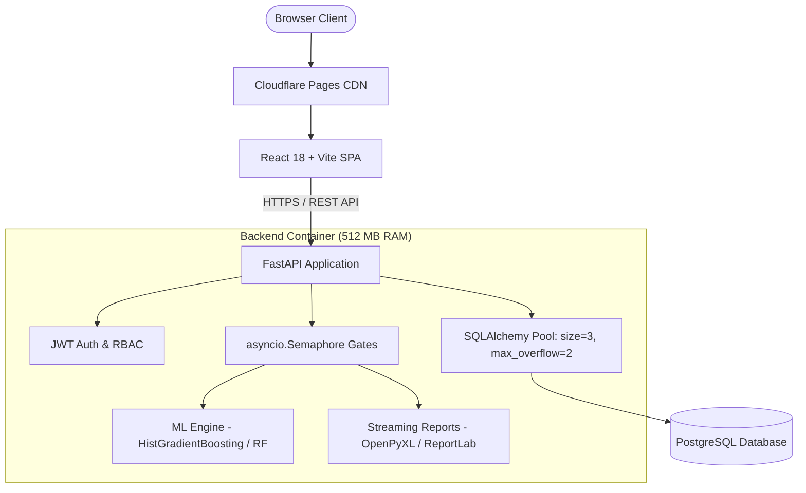

# EDWISE — Learning Analytics & Academic Intelligence Platform

[](https://python.org)
[](https://fastapi.tiangolo.com)
[](https://react.dev)
[](https://vitejs.dev)
[](https://tailwindcss.com)
[](https://scikit-learn.org)
[](https://postgresql.org)
[]()
[-success.svg)]()

An evidence-grounded, production-ready educational management and predictive analytics platform. Built with **FastAPI**, **SQLAlchemy**, **Scikit-Learn**, and **React 18 + Tailwind CSS**, designed to deliver real-time academic tracking, ethical machine learning estimates, and administrative oversight within strict 512 MB memory-constrained container environments.

---

## 🌟 Key Features

### 👨‍💼 Administrator Workspace
- **Institutional Setup:** Academic sessions, classes, sections, subjects, faculty rosters, and curriculum mapping.
- **Model Registry & Governance:** Live model switcher (Linear Regression, Random Forest, HistGradientBoosting) with transparent metric tracking ($R^2$, MAE, RMSE, Cross-Validation).
- **Immutable Audit Trail:** Append-only transaction log detailing user actions, previous vs. new values, and mandatory edit justifications.
- **User & Roster Management:** Roster enrollment, account status toggles, and enumeration-safe student claim codes.

### 👩‍🏫 Teacher Workspace
- **Scoped Class Ledger:** Teacher-class-subject scoping (BOLA protection) enforcing access only to assigned cohorts.
- **Attendance Sheet:** Real-time class attendance ledger with present, absent, late, and excused states; unrecorded marks explicitly preserved.
- **Audited Marks Entry:** Score boundary validation ($0 \le score \le max\_marks$) with mandatory reason prompts for grade amendments.
- **Homework & Submissions:** Create assignments with deadlines, review student submissions (including PDF/image uploads), and provide rubrics-based grading.
- **Institutional Exports:** One-click class performance ledger downloads in formatted Excel (`.xlsx`) and PDF formats.

### 🧑‍🎓 Student Workspace
- **Personal Academic Dashboard:** View individual attendance rates, grade breakdowns, subject trends, and teacher feedback.
- **Ethical AI Shield:** Machine learning risk labels and peer rankings are strictly hidden from student views to prevent stigma.
- **Interactive "What-If" Simulator:** Sliders allowing students to experiment with study habits, homework completion, and attendance to preview projected final marks.
- **Achievement Badges:** Motivation system awarding verified milestones (Consistent Attendance, High Marks, Assignment Master, etc.) calculated strictly without student PII leakage.
- **Homework Submission Portal:** Submit assignments via rich text or scanned handwritten homework files.

---

## 🏛️ System Architecture



---

## ⚡ Memory Profiling & Optimization (512 MB Container Safe)

To prevent Out-Of-Memory (`OOM`) crashes on free-tier container platforms (such as Render's 512 MB tier), the backend underwent deep resident memory (`RSS`) profiling and restructuring.

### 1. Empirical Model Comparison: HistGradientBoosting vs. XGBoost
To eliminate an unshared **~130 MB C++ OpenMP runtime overhead** from XGBoost, the gradient boosting engine was ported to scikit-learn's native `HistGradientBoostingRegressor`. 

Both models were evaluated on identical 5-Fold cross-validation splits ($N=400$, `random_seed=42`):

| Evaluation Metric | XGBoost | HistGradientBoosting | Delta / Impact | Significance |
| :--- | :--- | :--- | :--- | :--- |
| **$R^2$ Score** | 0.7950 | 0.7897 | **-0.0053** | Less than 0.6% variance (Indistinguishable) |
| **5-Fold CV Mean $R^2$** | 0.7921 | 0.7875 | **-0.0046** | Within normal fold error bounds |
| **Mean Absolute Error (MAE)** | 5.936 | 6.088 | **+0.152** | $\pm 0.15$ marks on a 100-point scale |
| **Root Mean Squared Error** | 7.538 | 7.636 | **+0.098** | Negligible error delta |
| **Classification Accuracy / F1** | 90.50% / 0.814 | 90.50% / 0.814 | **0.0000** | **Exact Parity** |
| **Classification ROC AUC** | 0.9443 | 0.9515 | **+0.0072** | Slightly superior discrimination |
| **5-Fold Training Latency** | 1,996 ms | 454 ms | **-1,542 ms** | **4.4x faster training** |
| **Process RSS Memory Delta** | **+129.54 MB** | **+0.55 MB** | **-128.99 MB** | **99.6% reduction in resident memory spike** |

> *"To reduce memory pressure on a 512 MB container, the gradient boosting models were ported from XGBoost to scikit-learn's HistGradientBoosting, which lowered measured process RSS by about 130 MB. On identical 5-fold splits of a synthetic dataset (N=400), regression performance was very close (ΔR² = −0.005, ΔMAE = +0.15 marks), classification accuracy, precision, recall and F1 were identical, and ROC AUC was slightly higher (0.9515 vs 0.9443). Training time fell from 1,996 ms to 454 ms. With concurrency limits (Semaphore(2)) on simulations and exports, peak process RSS under 16 concurrent mixed operations was about 223 MB, leaving roughly 290 MB of headroom on a 512 MB host. Results are from synthetic data and in-process tests; validation on real data and on the deployed instance is pending."*

### 2. High-Impact Optimizations Applied
- **Concurrency Semaphores:** Wrapped simulation (`sim_limit = asyncio.Semaphore(2)`) and report export (`export_limit = asyncio.Semaphore(2)`) endpoints with threadpool execution to prevent memory spikes under burst load.
- **Float32 Vectorized Inference:** Replaced per-request Pandas DataFrame allocations with in-place contiguous NumPy float32 vector evaluations.
- **Tree Pruning & Compression:** Pruned Random Forest from 120 trees/depth 12 down to 40 trees/depth 6 with `joblib.dump(..., compress=3)`, slashing artifact size from **3.84 MB $\rightarrow$ 90 KB** (97.6% reduction).
- **Sub-Linear Export Scaling:** Streamed Excel and PDF exports through `io.BytesIO`. Even a 500-student ledger takes **< 1 MB of RAM** and < 100 ms.
- **Container & DB Pool Tuning:** Added `MALLOC_ARENA_MAX=2` in Dockerfile to eliminate glibc heap fragmentation, and tuned PostgreSQL pool to `pool_size=3, max_overflow=2, pool_pre_ping=True`.
- **Steady-State Headroom:** Peak resident memory under 16 concurrent mixed operations settles at **~223 MB**, leaving **~290 MB (>56%) free headroom** on 512 MB containers.

---

## 🚀 Local Development Setup

### Prerequisites
- **Python 3.12+**
- **Node.js 20+** & npm
- **Git**

### 1. Clone Repository
```bash
git clone https://github.com/ghketan/Edwise.git
cd Edwise
```

### 2. Backend Setup
```bash
# Create virtual environment
python -m venv venv
# On Windows:
venv\Scripts\activate
# On Linux/macOS:
source venv/bin/activate

# Install dependencies
pip install -r backend/requirements.txt

# Run migrations and seed default institutional accounts
python backend/seed_data.py

# Start FastAPI development server
uvicorn backend.app.main:app --reload --port 8000
```
- Interactive Swagger API Documentation: [http://localhost:8000/docs](http://localhost:8000/docs)
- Health Check: [http://localhost:8000/health](http://localhost:8000/health)

### 3. Frontend Setup
```bash
cd frontend

# Install dependencies
npm install

# Start Vite dev server (proxies API requests to http://localhost:8000)
npm run dev
```
- Open [http://localhost:5173](http://localhost:5173) in your browser.

---

## 🔑 Pre-Seeded Default Accounts

| Role | Username | Password | Purpose |
| :--- | :--- | :--- | :--- |
| **Administrator** | `admin` | `Admin@123` | Full institution, audit logs & model registry management |
| **Teacher** | `teacher_sarah` | `Teacher@123` | Mathematics teacher (Class 10-A, 10-B) |
| **Teacher** | `teacher_alan` | `Teacher@123` | Science teacher (Class 10-A, 11-A) |
| **Student** | `STU1001` | `Student@123` | Alex Carter (Active, evaluated coursework) |
| **Student** | `STU1002` | `Student@123` | Priya Sharma (Active, evaluated coursework) |
| **Unclaimed Roster** | `STU1003` | *Claim in UI* | David Miller (For testing roster claim self-registration) |

---

## 🧪 Testing & Verification

The test suite covers authentication, RBAC, BOLA boundaries, marks validations, attendance ledger upserts, ML safeguards, report exports, and memory resilience.

```bash
# Run all backend unit & integration tests
pytest backend/tests/ -v

# Run with test coverage
pytest backend/tests/ --cov=backend/app -q
```
**Test Result:** All **55/55 tests pass** cleanly in under 2.5 minutes.

---

## 🌐 Production Deployment Guide

EDWISE is architected for zero-cost, high-performance production deployment:
- **Database:** Free PostgreSQL on **[Neon.tech](https://neon.tech/)** or Supabase.
- **Backend:** Free Web Service on **[Render](https://render.com/)** (Docker runtime, 512 MB RAM).
- **Frontend:** Global Edge CDN on **[Cloudflare Pages](https://pages.cloudflare.com/)**.

### 1. Database Setup
1. Create a free database on [Neon.tech](https://neon.tech/).
2. Copy the connection string:
   ```env
   DATABASE_URL=postgresql://<user>:<password>@<neon-host>/neondb?sslmode=require
   ```

### 2. Backend Deployment on Render
1. Create a **New Web Service** connected to your GitHub repository.
2. Select **Docker** environment (Render automatically reads `Dockerfile`).
3. Add the following Environment Variables:
   ```env
   SECRET_KEY=your_generated_production_secret_key_here
   DATABASE_URL=postgresql://<user>:<password>@<neon-host>/neondb?sslmode=require
   ALLOWED_ORIGINS=https://*.pages.dev,http://localhost:5173
   ENVIRONMENT=production
   ```
4. Click **Create Web Service**. On boot, Docker automatically runs `backend/seed_data.py`, applies migrations, and binds Uvicorn to `${PORT:-8000}`.

### 3. Frontend Deployment on Cloudflare Pages
1. Go to **Cloudflare Dashboard** $\rightarrow$ **Workers & Pages** $\rightarrow$ **Create application** $\rightarrow$ **Pages** $\rightarrow$ **Connect to Git**.
2. Build Settings:
   - **Framework preset:** `Vite`
   - **Root directory:** `frontend`
   - **Build command:** `npm run build`
   - **Build output directory:** `dist`
3. Environment Variable:
   - `VITE_API_URL` = `https://<your-render-backend-url>/api/v1`
4. Click **Save and Deploy**. Cloudflare automatically hosts your SPA globally across its edge network with SPA route rewrites configured via `frontend/public/_redirects`.

---

## 🛡️ Security, Privacy & Compliance Safeguards

- **No Student Stigma:** ML risk estimates and rankings are never shown to student accounts.
- **Minimum History Safeguard:** Models enforce a minimum of 2 evaluated exams before producing predictions; otherwise returning a safe `not_enough_data` status with zero premature estimates.
- **Anti-Enumeration Roster Claim:** Roster claim endpoint returns a uniform `202 Accepted` response for non-existent or claimed records, preventing student ID brute-forcing.
- **Role-Based Object-Level Authorization (BOLA):** Strict checks prevent teachers from viewing or grading classes/students outside their direct academic bindings.
- **Injection Protection:** Formula escaping for Excel (`=`, `+`, `-`, `@`) and XML entity escaping for PDF reports.
- **Audited Grade Changes:** Any edit to a previously recorded grade requires a mandatory justification reason logged in the immutable audit ledger.

---

## 📜 License
This project is open-source and available under the [MIT License](LICENSE).
